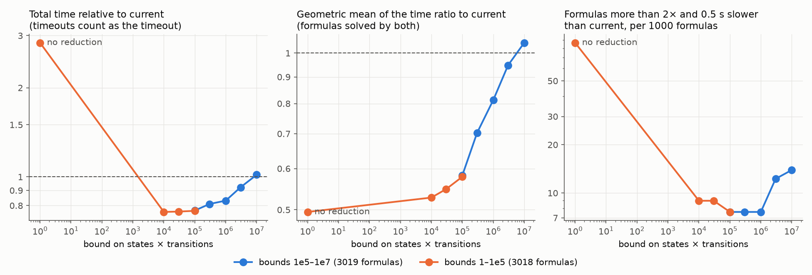
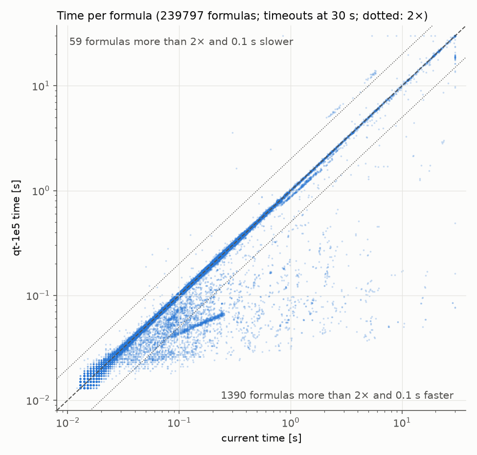
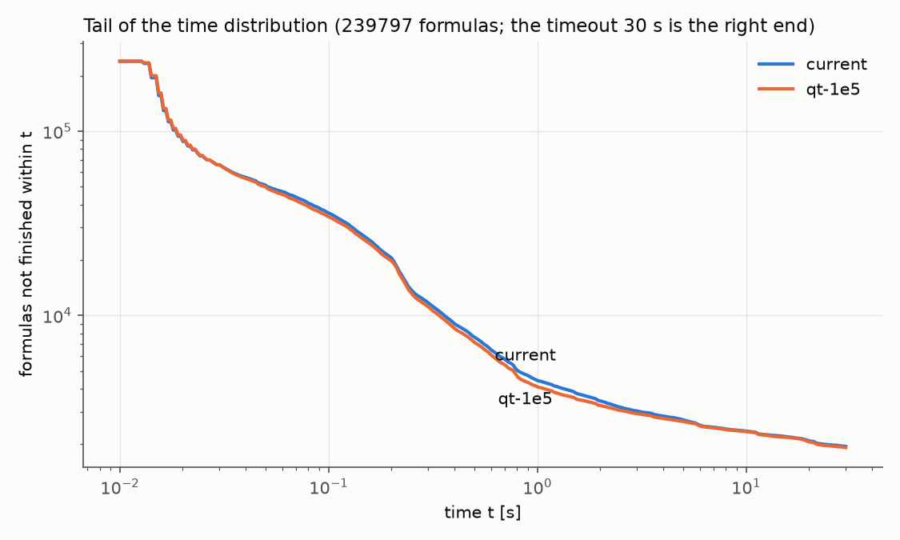
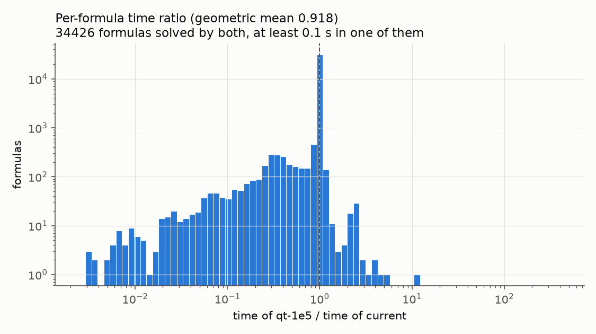
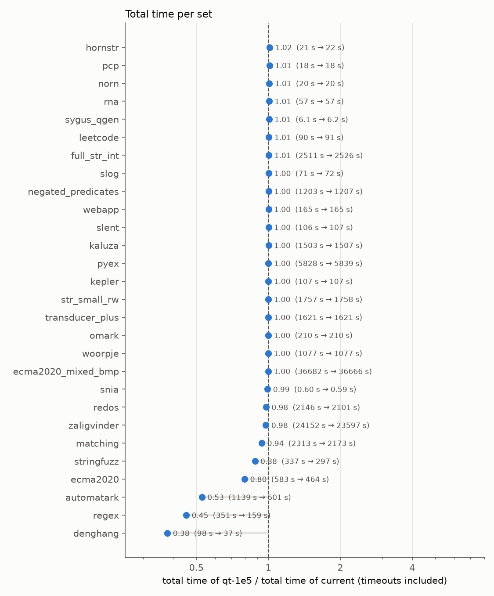

# Cost guard of the simulation reduction (night of 2026-11-04)

## Summary

- **Statistic.** The time of `mata::nfa::reduce` depends most on **Q·T**, the number of states times the number of transitions.
  Over the 3.5M distinct reduce calls of the whole smt-bench, its Spearman correlation with the time is 0.974, and its ROC AUC for "the call takes over 10 ms" is 0.997.
  The number of states alone, which today's bounds use, reaches only 0.73 and 0.985.
  Details: [../reduce-stats-2026-11-04/analysis/analysis.md](../reduce-stats-2026-11-04/analysis/analysis.md).
- **Guard.** `regex::should_reduce(nfa)` returns Q·T ≤ `REDUCTION_COST_BOUND`.
  It replaces both of today's bounds: `RED_BOUND` (fewer than 1000 states) at the construction and in the membership heuristics, and `INTERSECTION_RED_BOUND` (fewer than 100 states) at the final-check intersection.
  It also removes the reduction that today's code always applies to intersection arguments with at least 1000 states.
- **Bound.** I chose **1e5**.
  Bounds from 1e4 to 1e5 form a plateau, with total time at 0.76–0.77 of today's on the sample.
  Higher bounds are slower, and not reducing at all loses 194 formulas.
  Within the plateau, 1e5 has the fewest regressions.
- **Whole smt-bench (239,797 formulas), today's bounds vs Q·T ≤ 1e5.**
  - Total time: 0.980 of today's.
  - Time of the formulas solved by both: 0.947.
  - 27 more formulas solved (37 gained, 10 lost).
  - Percentiles 90–99.9 of the formulas solved by both: 2–16% lower (99th: 1.06 s → 0.89 s).
  - Regex-heavy sets: 0.38 (denghang), 0.45 (regex), 0.53 (automatark), 0.80 (ecma2020) and 0.88 (stringfuzz).
  - 470 formulas more than 2× and 0.5 s faster, 54 slower.

  See [Whole smt-bench](#whole-smt-bench-todays-bounds-vs-qt--1e5).
- **Why the regex-heavy sets gain.** Their formulas are memberships in real-world regexes over large alphabets.
  Their automata have few states but many transitions per state, so today's state bound reduces them and Q·T skips them.
  These reductions are expensive and barely shrink the automata.
  See [Why the regex-heavy sets gain](#why-the-regex-heavy-sets-gain).

The guard was committed afterwards as 018f0c981 (with its unit test in 868ee53c0).
The tools named below were replaced on 2026-11-05 by run_bench.py, report.py, plots.py and a rewritten reduce_cost_analysis.py
(see `perf-tools/README.md`); their outputs here are as they were made.
Binaries: `build/release-g/variants/{current,qt-*}/z3`.
`current` = HEAD b2f2ec58f; `qt-X` = the working tree with the bound X.

## Statistic

The collection run (all available smt-bench sets, no size bounds) recorded every reduce call with the properties of its automaton.
Top of the ranking of single properties (Spearman over the non-censored distinct calls; AUC for a call over 10 ms):

| property | Spearman | AUC > 10 ms |
|---|---|---|
| Q·M (states × (state, symbol) pairs) | 0.976 | 0.997 |
| **Q·T (states × transitions)** | 0.974 | 0.997 |
| Q·S (states × symbols) | 0.954 | 0.990 |
| transitions | 0.907 | 0.987 |
| states | 0.730 | 0.985 |

Q·M and Q·T are equally good; Q·T is simpler and needs only `num_of_states()` and `delta.num_of_transitions()`.
A cross-validated linear model of log(time) on log Q, log T and log S explains R² = 0.95 on the guarded sites, and Q·T alone explains 0.94.

The remaining scatter comes from the number of simulation classes, which is not known before the reduction:

| formula, site | Q | T | Q·T | result | time |
|---|---|---|---|---|---|
| lang_inclusion_1722, concat | 152 | 42,417 | 6.4e6 | 2 states | 38 ms |
| regex_7316, concat | 307 | 20,045 | 6.2e6 | 307 states (no reduction) | 15.7 s |

## Implementation (committed as 018f0c981)

- `src/smt/theory_str_noodler/regex.h`, `regex.cpp`: `REDUCTION_COST_BOUND = 100000` and `should_reduce`.
  Construction: `should_reduce(result)` replaces `num_of_states() < RED_BOUND`.
  Intersection: the arguments are no longer reduced when they have at least `RED_BOUND` states.
- `memb_heuristics_procedures.cpp`: `should_reduce` at the intersection and the union.
- `theory_str_noodler_final_check.cpp`: `should_reduce(intersection)` replaces `num_of_states() < INTERSECTION_RED_BOUND`.
- `src/test/noodler/regex.cpp`: test `regex::should_reduce`, for a separate test commit.
  It builds in `build/debug` and passes (`./test-noodler "[regex]"`: 2 test cases, 16 assertions).

## Choosing the bound

The sample contains the *affected* formulas: some guarded call of the collection is decided differently by a bound between 1e5 and 1e7 than by today's bounds.
It also contains a *control* sample of up to 100 unaffected formulas per set.

- Bench 1 ([REPORT-sample.md](REPORT-sample.md)): bounds 1e5, 3e5, 1e6, 3e6 and 1e7 against today's.
  I stopped it after 3,372 complete formulas to leave time for the whole smt-bench.
- Bench 2 ([REPORT-low.md](REPORT-low.md)): bounds 1, 1e4, 3e4 and 1e5.
  It ran on the 3,019 formulas of bench 1 on which not every solver timed out.
  Bound 1 means no reduction at the guarded sites.

Release build with `-g`, 10 parallel jobs on 12 cores, timeout 30 s, 6 GB address space per run.
Below, formulas on which every solver times out are left out.
"Faster" and "slower" mean more than 2× and 0.5 s faster or slower than today's bounds.

| bench | bound | solved (today: 2960) | gained | lost | total time / today's | time of commonly solved / today's | geometric mean of the ratio | median [s] (today: 0.094) | faster | slower |
|---|---|---|---|---|---|---|---|---|---|---|
| 2 | 1 (no reduction) | 2774 | 8 | 194 | 2.84 | 0.870 | 0.495 | 0.032 | 206 | 261 |
| 2 | 1e4 | 2967 | 10 | 3 | 0.761 | 0.766 | 0.528 | 0.040 | 205 | 27 |
| 2 | 3e4 | 2967 | 10 | 3 | 0.763 | 0.777 | 0.548 | 0.044 | 200 | 27 |
| 2 | **1e5** | 2967 | 9 | 2 | 0.768 | 0.779 | 0.579 | 0.049 | 198 | 23 |
| 1 | **1e5** | 2968 | 10 | 2 | 0.770 | 0.779 | 0.582 | 0.049 | 199 | 23 |
| 1 | 3e5 | 2967 | 8 | 1 | 0.810 | 0.823 | 0.703 | 0.063 | 193 | 23 |
| 1 | 1e6 | 2967 | 8 | 1 | 0.831 | 0.852 | 0.813 | 0.080 | 169 | 23 |
| 1 | 3e6 | 2966 | 8 | 2 | 0.922 | 0.952 | 0.948 | 0.092 | 98 | 37 |
| 1 | 1e7 | 2964 | 7 | 3 | 1.020 | 1.050 | 1.050 | 0.098 | 41 | 42 |

- The lower the bound, the faster, down to 1e5.
  Between 1e4 and 1e5, the total time is flat: 0.761, 0.763 and 0.768.
  Bound 1e5 came out at 0.770 and 0.768 in the two benches, so the noise is about ±0.01.
- Without any reduction (bound 1), typical formulas are fastest (geometric mean 0.495), but 194 formulas time out.
  So the cheap reductions are needed; only the expensive ones do not pay off.
- The median formula takes half the time (0.094 s → 0.049 s).
  In the collection, today's bounds allow 130k reductions with Q·T between 1e5 and 1e6, and the bound 1e5 skips them.
  They take 11 ms in the median (54 ms at the 90th percentile), 1,950 s in total.
  5,000 formulas make them, and 1,530 of those formulas spend more than half of their time in them.
- I chose 1e5 for three reasons:
  - It has the fewest regressions on the plateau (23 slower, 2 lost).
  - It keeps the most reductions, which also helps the unguarded code that follows.
  - The sample was selected by the decisions of the bounds from 1e5 to 1e7, so formulas affected only by lower bounds are underrepresented, and the lower bounds are less well tested.

Known cases (one run each):

| formula | today [s] | 1e5 [s] | 1e6 [s] | 1e7 [s] |
|---|---|---|---|---|
| regex_7316 | 14.57 | 0.05 | 0.05 | 14.56 |
| regex_6059 | 3.12 | 0.10 | 0.10 | 0.10 |
| lang_inclusion_1722 | 0.29 | 3.56 | 3.56 | 0.30 |
| random_mix_1041 | 3.52 | 7.37 | 7.42 | 3.51 |
| lang_ops_0145 | 0.15 | 0.16 | 0.15 | 0.77 |
| lang_ops_2448 | 0.23 | 0.24 | 0.23 | 2.82 |
| e2e memb-complex-term-assigned-literal-unsat | 0.02 | 0.02 | 0.02 | 0.02 |

All answers are the same as today's.

## Whole smt-bench: today's bounds vs Q·T ≤ 1e5

All 239,797 formulas of the available sets, each run once by each solver in a random order ([REPORT-full.md](REPORT-full.md)).
Release build with `-g`, 10 parallel jobs, timeout 30 s, 6 GB address space per run, 279 minutes.
Timeouts count as 30 s.
"Solved by both" = the 236,082 formulas both solvers answered correctly.

| statistic | today's bounds | Q·T ≤ 1e5 | ratio |
|---|---|---|---|
| solved | 236,092 | 236,119 | +27 |
| solved by this one only | 10 | 37 | |
| timeouts | 1,945 | 1,918 | 0.986 |
| unknown, error, out of memory | 1,157 | 1,157 | 1 |
| wrong (mislabeled benchmarks, see Notes) | 603 | 603 | 1 |
| **total time [s]** | 84,174 | 82,508 | **0.980** |
| mean [s] | 0.351 | 0.344 | 0.980 |
| median [s] | 0.017 | 0.017 | 1 |
| 90th percentile [s] | 0.168 | 0.161 | 0.958 |
| 95th percentile [s] | 0.292 | 0.274 | 0.938 |
| 97th percentile [s] | 0.538 | 0.496 | 0.922 |
| 98th percentile [s] | 0.870 | 0.788 | 0.906 |
| 99th percentile [s] | 8.45 | 8.04 | 0.952 |
| 99.5th percentile and max [s] | 30 (timeout) | 30 (timeout) | 1 |
| **solved by both: total time [s]** | 25,224 | 23,884 | **0.947** |
| solved by both: mean [s] | 0.107 | 0.101 | 0.947 |
| solved by both: median [s] | 0.017 | 0.017 | 1 |
| solved by both: 90th percentile [s] | 0.157 | 0.149 | 0.949 |
| solved by both: 95th percentile [s] | 0.248 | 0.242 | 0.976 |
| solved by both: 97th percentile [s] | 0.397 | 0.375 | 0.944 |
| solved by both: 98th percentile [s] | 0.582 | 0.543 | 0.933 |
| solved by both: 99th percentile [s] | 1.063 | 0.889 | 0.836 |
| solved by both: 99.5th percentile [s] | 2.51 | 2.18 | 0.866 |
| solved by both: 99.9th percentile [s] | 15.8 | 14.3 | 0.904 |
| formulas over 1 s | 4,433 | 4,096 | 0.924 |
| formulas over 10 s (timeouts included) | 2,354 | 2,341 | 0.994 |

Per formula (solved by both; times below 0.01 s count as 0.01 s):

| statistic | value |
|---|---|
| geometric mean of the time ratio, all solved by both | 0.992 |
| geometric mean of the time ratio, solved by both and at least 0.1 s in one of them (34,426 formulas) | 0.918 |
| time within ±10% of today's | 94% of the formulas |
| more than 2× and 0.5 s faster / slower | 470 / 54 |
| more than 1 s faster / slower | 350 / 74 |

Per set (total time, timeouts included; full table with the solved formulas and the 99th percentiles in [REPORT-full.md](REPORT-full.md)):

| set | formulas | today: solved | 1e5: solved | today: total [s] | 1e5: total [s] | ratio |
|---|---|---|---|---|---|---|
| denghang | 999 | 998 | 999 | 98 | 37 | 0.38 |
| regex | 2,172 | 1,567 | 1,568 | 351 | 159 | 0.45 |
| automatark | 15,995 | 15,988 | 15,989 | 1,139 | 601 | 0.53 |
| ecma2020 | 8,815 | 8,707 | 8,708 | 583 | 464 | 0.80 |
| stringfuzz | 11,618 | 11,618 | 11,618 | 337 | 297 | 0.88 |
| matching | 246 | 204 | 224 | 2,313 | 2,173 | 0.94 |
| zaligvinder | 118,157 | 117,562 | 117,563 | 24,152 | 23,597 | 0.98 |
| redos | 3,287 | 3,283 | 3,285 | 2,146 | 2,101 | 0.98 |
| ecma2020_mixed_bmp | 4,000 | 2,479 | 2,480 | 36,682 | 36,666 | 1.00 |
| the other 19 sets | 74,508 | | | | | 0.99–1.02 |

Plots:

- Time per formula. Most formulas lie on the diagonal; the guard helps a cloud of formulas between 0.05 s and 30 s.
  
- Formulas not finished within t. The curves split between 0.3 s and 3 s.
  
- Histogram of the per-formula time ratio, formulas taking at least 0.1 s.
  
- Total time per set.
  

On the whole smt-bench, the change is small: 2% of the total time and 5% of the time of the formulas solved by both.
Most formulas never reach a reduction that the two rules decide differently.
The gains are concentrated in the regex-heavy sets (denghang, regex, automatark, ecma2020, stringfuzz), whose total time drops by 12–62%.
The guard solves 27 more formulas.
It loses 10, and 8 of those losses reproduce (see below).

## Why the regex-heavy sets gain

The numbers come from the no-guard collection ([its analysis](../reduce-stats-2026-11-04/analysis/analysis.md)), where every automaton was reduced.
Each call at a guarded site, weighted by its repeats, is classified by what today's bounds and Q·T ≤ 1e5 would decide.
"Skipped" means a reduction that today's bounds do and the guard does not.
The opposite case (the guard reduces, today's bounds don't) takes 1.3 s on the whole smt-bench, 1.2 s of it in ecma2020_mixed_bmp.

**The formulas.**
The three sets that gain the most are mostly memberships `(str.in_re X R)` of one string variable in real-world regexes, with almost no word equations:
- automatark: regexes of the AutomatArk collection, several positive and negated memberships per formula.
- regex (regex-smt-benchmarks): regexes from regexlib.com, membership and inclusion queries (`notsubset_*`).
- denghang: a real-world regex and a sanitizer regex that forbids `<>'"&` anywhere in X.

Their regexes use many character classes, e.g. `re.range "a" "z"`, `re.allchar` (any character) and `re.diff re.allchar (re.range "0" "9")` (any non-digit).

**Why the two rules disagree on them.**
Noodler's alphabet is the characters of the formula plus one symbol for all the others, and mata stores one transition per symbol.
A character class therefore becomes tens of transitions out of each state.
The skipped reductions have a median of 130–160 states in these sets, so they pass the 1000-state bound.
They have 15–90 transitions per state, so their Q·T is over 1e5.
They also barely help: the median reduced automaton keeps 98–99% of the states in automatark and regex, and 69% in denghang.

| set | median alphabet | skipped: median states | skipped: median transitions per state | skipped: median states kept | skipped: time [s] | share of the set's total time | total time ratio, full run |
|---|---|---|---|---|---|---|---|
| denghang | 33 | 160 | 15 | 69% | 64 | 48% | 0.38 |
| automatark | 61 | 137 | 18 | 99% | 567 | 42% | 0.53 |
| regex | 64 | 134 | 93 | 98% | 204 | 39% | 0.45 |
| ecma2020 | 62 | 61 | 122 | 100% | 189 | 31% | 0.80 |
| stringfuzz | 24 | 294 | 2.9 | 79% | 46 | 11% | 0.88 |
| ecma2020_mixed_bmp | 73 | 52 | 73 | 55% | 1,380 | 3.7% | 1.00 |
| zaligvinder | 31 | 95 | 30 | 98% | 656 | 2.6% | 0.98 |
| matching | 27 | 656 | 38 | 55% | 86 | 2.4% | 0.94 |
| the other 20 sets | | | | | at most 54 each | < 1% | 0.98–1.02 |

The share is the time of the skipped reductions over the set's total time in the collection.
The sets with the largest share are the ones whose total time drops the most in the full run.

Where the skipped reductions are:
- automatark: the reduction after a concatenation at the construction (316 s) and the union of the negated memberships in the membership heuristic (215 s).
- regex: the reduction after a concatenation at the construction (143 s), then after star, intersection and union (15–20 s each).
- denghang: 56 of its 64 s are in the membership heuristic's intersection of the two regexes.
  For example, in `instance51221` it has 502 states and 9,636 transitions and reduces to 223 states.

**Why the other sets don't change.**
- In 15 sets (e.g. kaluza, woorpje, norn, leetcode, pcp), the two rules decide every reduction the same way.
  Their automata are small and have few transitions per state.
- redos and matching spend most of their time in reductions (96% and 78% in the collection).
  These reductions are of automata with at least 1000 states and a huge Q·T, which both rules skip: 29,007 of the 29,100 s of redos and 2,685 of the 2,770 s of matching.
- zaligvinder contains a copy of automatark (`models/automatark25`, 568 of its 656 s skipped), plus stringfuzz-generated formulas (46 s) and PyEx (41 s).
  Spread over its 118k formulas, its total time drops only to 0.98.
- ecma2020_mixed_bmp skips 1,380 s, 1,170 s of it at the final-check intersection.
  Its 1,100 timeouts dominate its total time, and some of the skipped intersections cause its losses (e.g. `random_mix_3208` below).

The shares are an estimate.
The collection reduced every automaton, so the later automata differ from the runs of both solvers, and a skipped reduction can make the later work slower or faster.

## Where the guard loses

The 10 formulas lost on the whole smt-bench, each run twice more with both solvers:

| formula | set | today [s] | 1e5 [s] |
|---|---|---|---|
| lang_inclusion_0092 | ecma2020_mixed_bmp | 0.85, 0.85 | timeout, timeout |
| notsubset_8_8 | regex | 5.3, 5.4 | timeout, timeout |
| random_mix_3208 | ecma2020_mixed_bmp | 7.3, 7.3 | timeout, timeout |
| random_mix_3418 | ecma2020_mixed_bmp | 8.8, 8.9 | timeout, timeout |
| lang_ops_3444 | ecma2020_mixed_bmp | 12.0, 12.1 | timeout, timeout |
| wildcard-matching-regex-04 | matching | 15.5, 15.5 | timeout, timeout |
| random_mix_0146 | ecma2020_mixed_bmp | 18.0, 18.0 | timeout, timeout |
| random_mix_0836 | ecma2020_mixed_bmp | 19.4, 19.6 | timeout, timeout |
| random_mix_0508 | ecma2020_mixed_bmp | 12.6, 12.8 | 29.6, 29.8 (at the timeout) |
| 76 (wildcard) | matching | 28.5, 29.1 | 28.0, 29.2 (noise) |

The reductions that the guard skips, from the collection:
- `notsubset_8_8`: two concatenations with Q·T ≈ 1.6e7 shrink from 393 states and 40k transitions to 133 states and 12k transitions in 0.2 s each.
  Without them, the later work explodes.
- `random_mix_3208`: a final-check intersection with 68 states and Q·T = 2.3e5 shrinks to 18 states in 6 ms.
  Today's bound (fewer than 100 states) reduces it.
- `lang_inclusion_0092`: the skipped reductions (Q·T from 3.8e5 to 5.1e6) shrink the automata only a little: 1–10% of the states and 16–29% of the transitions.
  Yet the formula goes from 0.85 s to a timeout.
  The cause is downstream and still unknown.

- **matching, `wildcard-matching-regex-*`.**
  The effect is the same for every bound, because it comes from intersections of automata with Q·T from 3e7 to 8e8.
  - `-54` (and about 10 similar formulas) gets slower, 5.6 s → 13.7 s.
    Its two concatenations have 925 and 960 states and Q·T ≈ 3.4e7.
    Today's code reduces them at construction (fewer than 1000 states) in 1.5 s each, which halves the arguments of the following intersection.
  - `-02` gets slower, 19 s → 27–30 s.
    Its concatenations have about 1800 states and Q·T ≈ 9e7.
    Today's code reduces them as intersection arguments with at least 1000 states (4 s each).
  - `-16`, `-20`, `-24`, `-52`, `-56` and `-76` get solved (timeout → about 18 s).
    Their concatenation has 4,999 states and Q·T = 7.6e8.
    The same intersection-argument rule reduces it today, which takes more than 30 s.
  - In total for the set: 62 → 68 solved formulas in the sample, at about the same total time.
    The size of an intersection is the product of the sizes of its arguments, so reducing the arguments is worth more than an ordinary reduction.
    A higher bound for intersection arguments only (e.g. 1e8) would keep `-54` and `-02` fast and still skip `-16`.
    I have not tried it.
- **lang_inclusion_1722** (0.29 s → 3.6 s): its concatenation (Q·T = 6.4e6) reduces from 152 states to 2 in 38 ms, and the guard skips it.
  Q·T can't predict this; the number of simulation classes would.
- **random_mix** (ecma2020_mixed_bmp): a few formulas get 2× slower (e.g. random_mix_1041, 3.5 s → 7.4 s) or time out, and others get solved.

## Notes

- 603 of the 1,906 formulas of `regex-smt-benchmarks/regexlib_membership/sat` are answered unsat, both with today's bounds and with the guard (22 of them in the sample).
  They are all the wrong answers of the whole smt-bench.
  The runner takes the expected answer from a status line that is commented out in these files (`;(set-info :status sat)`).
  It comes from .NET semantics, where `^` and `$` bind only to the first and last alternative.
  I checked `membership_72`: its SMT regex has no `re.all`, so every alternative is anchored.
  The second witness starts with characters that no alternative accepts.
  Asserted alone, the first witness gives sat and the second gives unsat, so unsat is correct and the label is wrong.
  This is not related to the guard.
- The control group of the sample also contains the formulas that timed out in the collection, because their calls could not be classified.
  These are the 6 `wildcard-matching` formulas above.
- Sites with no size guard still reduce automata of any size.
  From the no-guard collection, for the whole smt-bench:
  - `FormulaPreprocessor::reduce_automata` (formula_preprocess.cpp:1154): 6,310 s, longest call 30 s.
    It may also reduce again the automata that the guard skipped.
  - mata `noodlify_for_equation`: 3,120 s.
  - mata `segs_one_initial_final`: 2,080 s in 18.4M calls.
  - `refine_languages` (formula_preprocess.cpp:1145): 787 s.
  - `AutAssignment::reduce` (aut_assignment.h:407): 145 s.
  - `process_transducer`: 51 s.

## Open ideas

- A higher bound for the arguments of an intersection or another product (see matching above).
- Guard `reduce_automata` with the same `should_reduce`.
- For deterministic automata, minimization would be cheaper than the simulation (regex_6059: 626 states, deterministic, acyclic, 3.8 s).
- A cheap estimate of the number of simulation classes, e.g. from the outgoing symbols of the states, would separate lang_inclusion_1722 from regex_7316.

## Files

- Reports: [REPORT-sample.md](REPORT-sample.md), [REPORT-low.md](REPORT-low.md) and [REPORT-full.md](REPORT-full.md), generated by `perf-tools/guard_bench_report.py`.
- Plots: `plots/`, generated by `perf-tools/guard_bench_plots.py`.
- All benches ran `perf-tools/smtbench_run.py` with 10 jobs, timeout 30 s, 6 GB address space per run and seed 1105.
  The whole smt-bench is all available sets, deduplicated, with ECMAScript engine semantics for ecma2020_mixed_bmp.
- The raw data (the benchmark CSVs, the formula lists, the run logs and the statistics collection) were deleted after the analysis.
